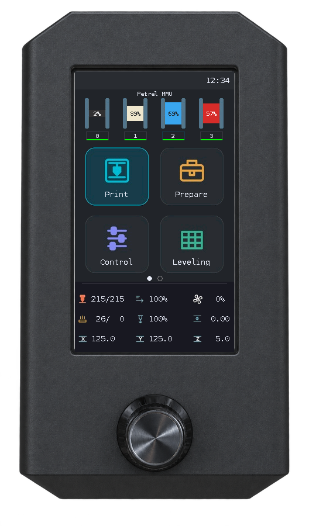
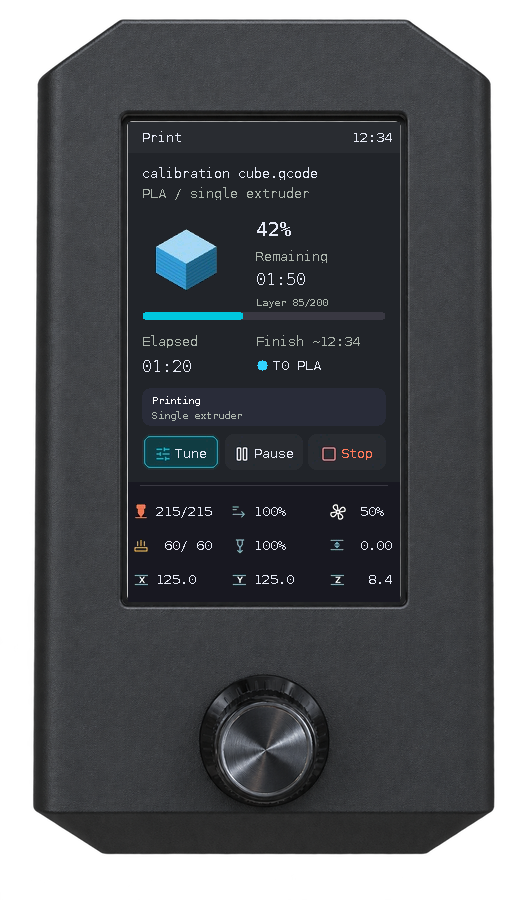
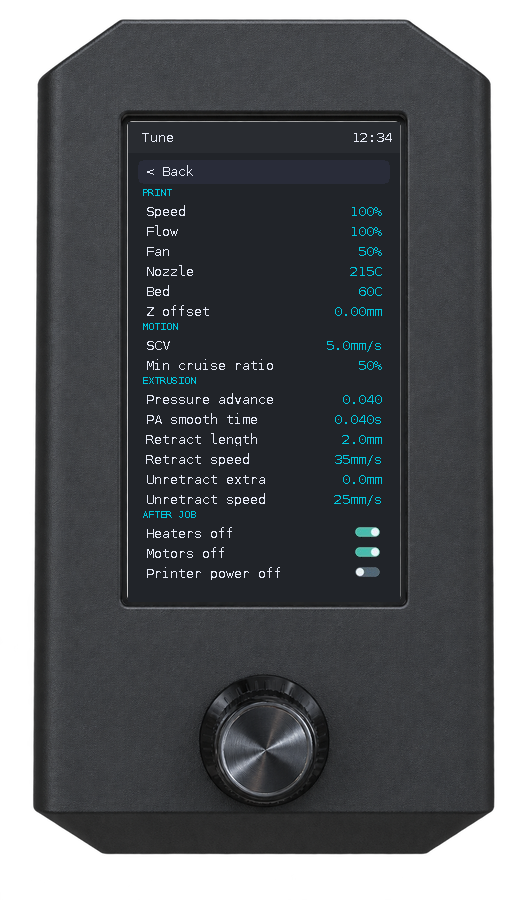

<p align="center">
  
</p>

**A lightweight printer UI for supported stock DWIN displays, powered by Moonraker.**

Reuse the compatible Ender 3 V2 screen after moving to Klipper: choose a file, adjust a print, prepare the bed and inspect filament from the printer's rotary encoder.

[English](README.md) · [Türkçe](README_TR.md) · **[Install Petrel](docs/installation.md)** · [Display compatibility](docs/lcd-assets.md)

<p align="center">
  
  
  <a href="LICENSE"></a>
</p>

<p align="center">
  <a href="docs/assets/screens/home.png"></a>
  <a href="docs/assets/screens/printing.png"></a>
  <a href="docs/assets/screens/tune.png"></a>
</p>

**Open full size:** [Home](docs/assets/screens/home.png) · [Print](docs/assets/screens/printing.png) · [Tune](docs/assets/screens/tune.png).

*Real UI/driver emulator output with example data; these are not photographs or physical measurements. [Explore the screens](docs/screenshots.md).*

## Why Petrel?

A supported stock display can lose its original role when the printer moves to Klipper. Petrel puts everyday controls back beside the printer, so checking a print or adjusting a temperature does not always require a phone or browser. You keep the supported panel; a Linux SBC, wiring and a working Klipper/Moonraker setup are still required.

The interface uses the existing encoder and native panel drawing commands. The host runs a Python service and receives printer status through Moonraker's WebSocket subscription. “Lightweight” describes that architecture; this project does not publish comparative CPU, RAM or latency benchmarks. KlipperScreen serves a different hardware/UI choice with a touch display; choose the interface that suits your equipment and workflow.

## Everyday controls and optional integrations

| Task | Available on the LCD |
|---|---|
| Choose a print | Nested folders, Mainsail sorting, model thumbnail, estimated time and slicer filament/tool metadata when available |
| Manage a print | Progress/time, optional layers, direct Pause/Resume, confirmed Stop and Close after completion |
| Tune | Speed/Flow, fan and temperatures, session Z offset, SCV/minimum cruise ratio, PA/smoothing and firmware retraction when supported |
| Prepare and calibrate | Homing, steppers, XYZ/extruder movement, Live jog, presets/cooldown, bed mesh, four-corner screw adjustment and probe-offset calibration |
| Happy Hare MMU | Live filament path/purge, gates, load/unload, bypass, tool map, EndlessSpool, explicit recovery, supported LEDs and multiple units |
| Spoolman | Spool IDs and gate material/color; remaining percentage when the Happy Hare/Spoolman integration supplies it |
| Display and system | Brightness/dimming, buzzer/tones, network/host/MCU/software status, QR link and idle-time Petrel updates |
| Light and power | Configured PWM case light and Moonraker power device; encoder hold with confirmation and active-print blocking |
| After Job | Three optional policy switches; only set pins, while your macros perform end-print actions |

MMU and Spoolman are optional. Menus depend on discovered configuration and valid status; on-screen labels remain English. Maintenance currently contains only Back. See the [complete Print/Tune field table](docs/print-controls.md).

## Compatibility and requirements

- **272×480 portrait DWIN T5UIC1**, including the compatible 4.3-inch Ender 3 V2 panel. Other DWIN models and DACAI/TJC are not implied to work.
- Raspberry Pi or compatible Linux SBC with UART/GPIO and **Python 3.11+**.
- Working **Klipper and Moonraker**, authorized network access, crossed TX/RX and configured encoder pins.
- The bundled LCD font, installed once using the panel's SD update procedure; boot artwork and icons synchronize automatically over UART.

Check [display/resources](docs/lcd-assets.md) and [wiring](docs/installation.md#wiring-and-serial-setup) before starting. Existing supported hardware avoids buying a replacement display; it does not remove the SBC/cable requirements.

## Quick start

> **⚠️ Important — Petrel permanently changes LCD artwork.** On supported DWIN T5UIC1 screens, current Petrel releases automatically replace the stock boot JPEG and icon-library data in the LCD's non-volatile Picture Flash with resources optimized for Petrel's interface and drawing performance. Updating or uninstalling the Pi software alone **does not restore the stock images**. To return to Creality's original icons and JPEGs, stop Petrel and flash the [bundled original DWIN_SET](assets/stock-dwin/DWIN_SET) through the **LCD's microSD slot**; follow the [stock restoration guide](docs/restore-stock-dwin.md). This does **not** restore the printer mainboard firmware.

Install Petrel:

```bash
cd ~
git clone https://github.com/sezgynus/Petrel.git
cd ~/Petrel
./install.sh
```

The installer prepares dependencies, `Petrel.service`, external settings and Moonraker Update Manager. Complete the [LCD font and first-start checks](docs/installation.md#lcd-resources-and-first-start). You can update Petrel through Moonraker Update Manager or the LCD Info screen; see the [update guidance](docs/installation.md#update). Existing installations preserve settings during [migration](docs/installation.md#update).

To change connection/encoder/power settings later, run `./configure.sh` from `~/Petrel`. Rotate to navigate and press to select; confirm numeric values by rotating and pressing again. The Tune editor uses **Apply**; some pages also require **Save**. **Back** returns; keep rotating to move between Home pages.

## Find the right guide

| Guide | What you will learn |
|---|---|
| [Installation and configuration](docs/installation.md) | Wiring, LCD font, first start, settings, updates and troubleshooting |
| [Daily use](docs/user-guide.md) | Dashboard units, file selection, movement, heating, calibration, Display, Info and power |
| [Print and Tune](docs/print-controls.md) | All 17 possible fields, command outcomes, optional job switches and MMU error flow |
| [MMU and filament](docs/mmu-guide.md) | Gates/spools, mapping, EndlessSpool, bypass, state reporting and recovery |
| [Screenshot gallery](docs/screenshots.md) | Framed previews with original panel PNG links |
| [Documentation index](docs/README.md) | User and contributor routes plus optional historical references |

Runtime settings do not replace persistent Klipper/probe configuration. Screw adjustment needs a probe and four configured corner screws. Viewing a mesh does not activate it; saving restarts Klipper and explicitly stopping a measurement shuts it down. MMU calibration/custom LED effects stay in the web UI. After an uncertain command, check actual printer state before retrying.

## Architecture and development

Petrel translates subscribed Moonraker state and encoder input into T5UIC1 UART drawing commands. Thumbnails use panel SRAM; managed boot/icon resources use Picture Flash and fingerprints to avoid uploading unchanged blocks. Persistent display/buzzer records use separate Data Flash.

Discovery reads Moonraker's object list and configuration when a connection is established; it repeats after reconnect. Capability/status models determine visible controls and limits. This is conditional menu visibility, not dynamic module loading. A new MMU protocol would need status mapping, command adaptation and tests in addition to detection.

Start with [Contributing](CONTRIBUTING.md), [tests](tests/README.md), [PNG/GIF reproduction](docs/ui-emulator.md#render-documentation-screens-offline) and [icon sources](assets/icons/README.md). For physical panel work use the optional [protocol reference](docs/t5uic1-reference.md).

## Credits and license

This project grew from [odwdinc/DWIN_T5UIC1_LCD](https://github.com/odwdinc/DWIN_T5UIC1_LCD) and [bustedlogic/DWIN_T5UIC1_LCD](https://github.com/bustedlogic/DWIN_T5UIC1_LCD). Original copyright notices and Git history are retained.

Integrations use [Klipper](https://github.com/Klipper3d/klipper), [Moonraker](https://github.com/Arksine/moonraker), [Mainsail](https://github.com/mainsail-crew/mainsail), [Happy Hare](https://github.com/moggieuk/Happy-Hare) and [Spoolman](https://github.com/Donkie/Spoolman).

Licensed under **GNU GPL v3.0**; see [LICENSE](LICENSE).
