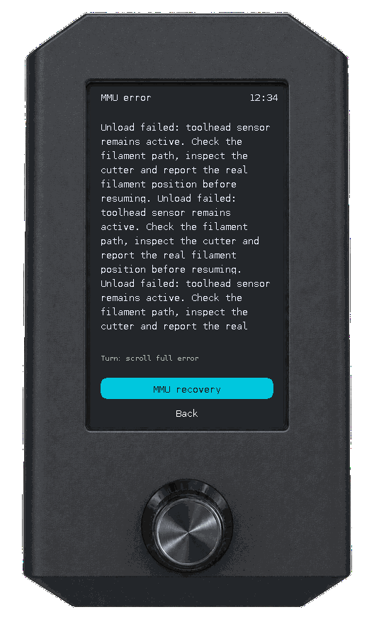

# MMU ve filament

[English](mmu-guide.md) · [Türkçe](mmu-guide_TR.md) · [Dokümantasyon](README_TR.md)

## MMU menüsünü açma

Happy Hare MMU yapılandırılmışsa **Home → MMU** seçin. Ana ekran kanal renklerini ve Spoolman verisi mevcutsa kalan filament yüzdelerini de gösterir. Spoolman bilgisi eksik olsa da diğer MMU işlevleri kullanılabilir.

  
  
  
  

Seçmek için çevirin; çalıştırmak için basın. Filament değiştirmek için renkli **T0, T1, …** düğmesini seçin: Happy Hare mevcut takımı boşaltıp seçtiğiniz takımı otomatik yükler. Her makaranın üstündeki kanal gerçek eşleşmesini gösterir; birkaç takım aynı kanalı kullanabilir. Dörtten fazla takım, çevirirken gruplar halinde görünür. **G0, Happy Hare kanal 0'dır**.

Dikey şema filamentin yüklenmesini ve geri çekilmesini takip eder. Filament algılandığında Gate dairesi yeşil dolar. Artık malzeme kaldığı sürece nozzle eski filament rengini korur; purge sırasında küçük bir filament çıkışı animasyonu görünür ve renk Happy Hare'in bildirdiği durumu takip eder. MMU ekranında nozzle sıcaklığı gösterilir; genel yazıcı bilgileri ana ekranda kalır.

Genel görünümdeki takım ve **Load/Unload** düğmeleri doğrudan çalışır ve şema ekranda kalır. **More**; kanalları, eşleştirmeyi, bypass'ı, yönetimi ve ayrıntılı durumu açar. Bu sayfalardaki işlemler onay açar; **başlangıçta Cancel seçilidir**. Normal hareket ve düzenlemeler baskı/duraklama dışında boşta MMU gerektirir. Desteklenmeyen seçenekler gizlenir; yazıcı durumu meşgul, bilinmiyor veya uygun değilse işlemler kilitlenebilir. Başarısız/doğrulanmamış işlemi tekrarlamadan önce gerçek yazıcıyı kontrol edin.

  

## Kanallar ve yükleme

  
  
  

**MMU → More → Gates → [kanal]** açın:

| İşlem | Kullanım |
|---|---|
| Select only | Fiziksel kanalı seçer; selector hareket edebilir |
| Load selected | O kanaldan filament yükler |
| Load / change | Kanala atanmış mantıksal takımı ve Happy Hare eşlemesini kullanır |
| Unload | Yüklü filamenti MMU'ya geri park eder |
| Eject spool | Filamenti MMU'dan çıkarır; gerekiyorsa önce aktif kanalı boşaltır |
| Preload | Happy Hare ile kanal filamentini hazırlar |
| Check | Seçili kanalı kontrol eder |
| Filament details | Ad, malzeme, renk, makara ID, kalan yüzde, sıcaklık ve Spoolman modunu gösterir |

Kabul etmeden önce ekrandaki kanal/takım hedefini kontrol edin. MMU ana ekranındaki Load/Unload kısayolu mevcut kanalda çalışır.

## Makara atamaları

  
  

**Gates → [kanal] → Filament details → Assign spool ID** açın. **Spool ID**'ye basın, pozitif sayısal ID'ye çevirin, düzenlemeyi kabul etmek için basın ve **Save** seçip onaylayın. **Cancel** taslağı iptal eder. Atamayı açıkça kaldırmak için **Clear assignment** kullanın.

Atama yapılandırılmış Spoolman moduna bağlıdır: bilinen `off`, `readonly` ve `push` yerel düzenlemeye izin verir; `pull` ve bilinmeyen modlar kilitli kalır. Gerekli filament bilgisi mevcut olmalıdır. Yinelenen ID uyarısı, ID'nin başka kanaldan taşınacağını belirtir. Makaranın varlığını doğrulayın; eşitleme bekliyorsanız ardından Spoolman'ı inceleyin.

## Takım eşlemesi

  

**MMU → More → Tool map** açın. Takımı seçip basın, kanalına çevirin ve kabul etmek için basın. Diğer takımlar için tekrarlayın; ardından **Save** seçip onaylayın veya taslağı silmek için **Cancel** seçin. Birden fazla takım aynı kanalı paylaşabilir.

Düzenlemeyi boşta ve baskı/duraklama dışında yapın. Düzenleme sırasında web arayüzünden eşleme değişirse devam etmeden önce düzenleyiciyi yeniden açın.

## EndlessSpool

  
  

**Tool map** içinden **EndlessSpool** açın. Uyumlu yedek makaraları gruplandırarak makara bittiğinde Happy Hare'in devam etmesini sağlar.

1. **Enabled**'a basın, istenen duruma çevirin ve kabul etmek için basın.
2. Grubu açıp üyelik eklemek/çıkarmak için kanallara basın. Çıkarılan üye ayrı grup olur; son üye grupta kalır.
3. Gösterilen malzeme/renk uyumunu ve fiziksel makaraları kontrol edin.
4. **Save** seçip onaylayın veya taslağı silmek için **Cancel** seçin. Üye sayfasından Back, taslağı korur.

Değişiklikleri boşta ve baskı/duraklama dışında yapın. Eşleşen metadata yol gösterir; gerçek filamentin yerine kullanıma uygun olduğunu doğrulayın.

## Bypass

  

**MMU → More → Bypass** açın. Önce **Unload current gate**, ardından **Select bypass** kullanın. Yalnız extruder filament yolu için **Load extruder** ve **Unload extruder** kullanın. Her işlemi onaylayın. Bypass seçimi boşaltılmış filament gerektirir.

## Kurtarma ve durum

  
  

  
  

Baskıda MMU hatası Print üzerinde özetlenir; **Resume** yerine **MMU** görünür. **Print → MMU → tam hata → MMU recovery** yolunu izleyin; uzun metni çevirerek kaydırın. **Back** Print'e döner. **MMU → More → Manage → Recover state** yolu da kullanılabilir. Genel görünüm işlemi başarısız olursa ana düğme **Recover** olur. [Print/Tune rehberi](print-controls_TR.md).

1. Hatayı okuyun ve fiziksel filament sorununu düzeltin.
2. Kurtarmayı veya gerçek kanal/takım/filament durumunu bildirmek için manuel durum düzenleyicisini kullanın. Manuel Apply durum bildirir; filament yüklemez veya boşaltmaz.
3. Gerekiyorsa kilidi açın/yeniden ısıtın.
4. Baskı duraklamış, MMU kilidi açık ve filament yüklü olduğunda ayrıca **Resume** seçin.

**Status** / **Sensors / status**, mevcut işlemi, varsa Bowden aşaması ilerlemesini, sensörleri, gear sync'i, nozul sıcaklığını ve işlem sonucunu gösterir. Bowden yüzdesi tüm takım değişimini değil o aşamayı belirtir. `CLEAR`, `TRIGGERED`, `UNKNOWN/OFF` ve `ABSENT` farklı sensör durumlarıdır.

Örnek verilerle gerçek UI emülatörü çıktısıdır; [tam hata ekranı](assets/screens/error-full.png).

## Bakım ve seçenekler

  
  

**Manage → Maintenance** veya **Manage → Options** açın. Kontroller kurulu Happy Hare yapılandırmasına ve bildirilen duruma bağlıdır:

| Sayfa / seçenek | Kullanım ve koşul |
|---|---|
| Maintenance → Check all gates | Yapılandırılmış tüm kanalları kontrol eder |
| Maintenance → Home selector | Desteklenen tek lineer selector ünitesinde sunulur; onay sonrasında seçilecek takımı belirtir |
| Maintenance → Grip / Release | Boşaltılmış filamentle desteklenen selector kavrama kontrolü; sürekli kavrayan ünitelerde Release yoktur |
| Options → Gear sync ON/OFF | Yüklü filamentle MMU dişlisi ve extruder senkronizasyonu; sürekli kavrayan üniteler senkronizasyondan çıkarılamaz |
| Options → Enable/Disable MMU | Baskı/duraklama dışında boşaltılmış filament gerektirir; açmak Happy Hare durumunu sıfırlar |
| Options → Release MMU motors | Destekleniyorsa MMU motorlarını bırakır; baskı/duraklama dışında boşaltılmış filament gerektirir, home bilgisi kaybolabilir |
| Options → LEDs | Aktif ünitede aç/kapat, animasyon ve çıkış modları: Off, Gate status, Filament color veya Slicer color |
| Options → Units | Çoklu üniteleri ve global kanallarını gösterir; Select this unit ilk kanalı seçmek için ayrı onay ister ve selector hareketi/home yapabilir |

Tek üniteli kurulumlarda Units görünmez. Ünite seçimi baskı/duraklama dışında boşaltılmış filament gerektirir. LED seçenekleri desteklenen aktif ünite LED bilgisi gerektirir. **MMU kalibrasyonu, özel LED efektleri ve entry/status/logo LED ayarları** için web arayüzünü kullanın.

  
  
  

