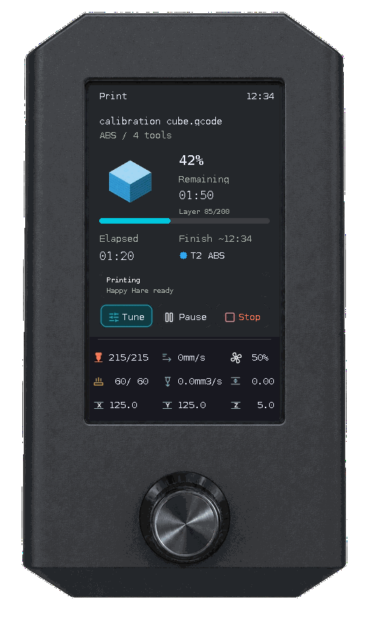
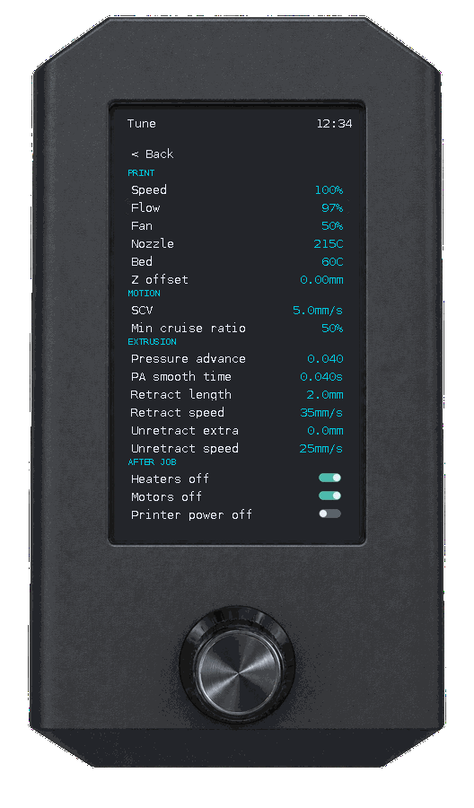

# Print ve Tune kontrolleri

[English](print-controls.md) · [Türkçe](print-controls_TR.md) · [Dokümantasyon](README_TR.md)

## Baskıyı yönetme

1. **Home → Print** üzerinden dosyayı seçip önizlemedeki **Print** ile başlatın.
2. İlerlemeyi, geçen/kalan süreyi ve tahmini bitiş saatini izleyin. Önizleme ve `print_stats.info` katman verisi isteğe bağlıdır; katman Z yüksekliğinden tahmin edilmez.
3. **Pause / Resume** doğrudan çalışır. **Stop** onay açar; başlangıçta **Back** seçilidir.
4. Stop onayından sonra yazıcı durumu iptali doğrulayana kadar Print ekranı, devre dışı **Stopping** düğmesiyle güncellenmeye devam eder. Beklerken iptal komutunu tekrar göndermeyin.
5. Baskı tamamlandığında veya iptal edildiğinde **Close** ile Home'a dönün.



Gerçek UI ve sürücünün çevrimdışı emülatör çıktısıdır; durum verileri örnektir. Üretim yöntemi: [emülatör rehberi](ui-emulator_TR.md).

## Tune ile ayarlama

**Tune → alan → çevir → Apply** yolunu kullanın. PRINT, MOTION, EXTRUSION ve AFTER JOB grupları aynı sayfadadır. Yalnız desteklenen cihazlar ve geçerli durum verisi için kontroller görünür; aşağıdaki 17 alan en geniş kapsamı gösterir.

| Grup | UI adı | Birim | Görünme koşulu | Etki |
|---|---|---|---|---|
| PRINT | Speed | % | Hazır yazıcı | M220 hız çarpanı |
| PRINT | Flow | % | Aktif hotend | M221 akış çarpanı |
| PRINT | Fan | % | Parça soğutma fanı | Fan hedefi, %0–100 |
| PRINT | Nozzle | °C | Aktif hotend | Nozul hedefi |
| PRINT | Bed | °C | Tabla ısıtıcısı | Tabla hedefi |
| PRINT | Z offset | mm | Çalışma zamanı offset desteği | Oturum ayarı; kalıcı probe kalibrasyonu değildir |
| MOTION | SCV | mm/s | Toolhead alanı bildiriyor | Kare köşe hızı |
| MOTION | Min cruise ratio | % | Toolhead alanı bildiriyor | Minimum cruise ratio; komuta değer / 100 gönderilir |
| EXTRUSION | Pressure advance | — | Aktif extruder PA bildiriyor | Çalışma zamanı pressure advance; UI birim göstermez |
| EXTRUSION | PA smooth time | s | Aktif extruder smooth_time bildiriyor | Pressure advance yumuşatma aralığı |
| EXTRUSION | Retract length | mm | firmware_retraction + durum verisi | Yazılımsal geri çekme mesafesi |
| EXTRUSION | Retract speed | mm/s | firmware_retraction + durum verisi | Yazılımsal geri çekme hızı |
| EXTRUSION | Unretract extra | mm | firmware_retraction + durum verisi | Geri beslemede ek uzunluk |
| EXTRUSION | Unretract speed | mm/s | firmware_retraction + durum verisi | Yazılımsal geri besleme hızı |
| AFTER JOB | Heaters off | On/Off | Turn_OFF_Heaters_After_Job | Yalnız politika pinini değiştirir |
| AFTER JOB | Motors off | On/Off | Disable_Motors_After_Job | Yalnız politika pinini değiştirir |
| AFTER JOB | Printer power off | On/Off | Power_OFF_Printer_After_Job | Yalnız politika pinini değiştirir; anında kapatmaz |

Ayarlar çalışma zamanında etkilidir; kalıcı varsayılanlar için Klipper yapılandırmasını ayrıca düzenleyin. Firmware retraction ayarları G10/G11 kullanımını etkiler; slicer'ın açık ekstrüzyon hareketlerini yeniden yazmaz.

Değer veya switch hemen yeni seçimi gösterir. Komut reddedilirse güncel abonelik değerine döner ve iki kez kısa kırmızı yanıp söner. Yavaş yanıt tek başına ret değildir. Eski yanıt yeni düzenlemeyi ezmez; yeniden bağlantı bekleyen düzenlemeleri geçersiz kılar. Sonuç belirsizse tekrar denemeden önce Mainsail'den kontrol edin.

## MMU hatasından devam etme

Happy Hare varsa aktif tool’un eşlendiği gate rengi/malzemesi gösterilir. Toolchange kaynağı üst düzey `last_tool`, bu alan yoksa `toolchange.from_tool` üzerinden okunur. Hedef üst düzey `next_tool`, bu alan yoksa `toolchange.next_tool` üzerinden okunur. Kaynak değeri eksik (`None`) ve bildirilen MMU eylemi `Idle`/`Unknown` dışında ise bildirilen aktif tool kaynak olarak kullanılabilir. Kaynak ve hedef geçerli, farklı tool ID’leri değilse kaynak/hedef değişim göstergesi çizilmez; eksik hedef tamamlanmaz.

1. MMU kilitlenince Print'te kalırsınız; hata özeti görünür ve **Resume** yerine **MMU** çıkar.
2. **MMU** ile tam hata okuyucusunu açın; uzun metni çevirerek kaydırın.
3. Kurtarma için **MMU recovery**, Print'e dönmek için **Back** seçin.
4. Fiziksel sorunu düzeltip [kurtarma adımlarını](mmu-guide_TR.md) uygulayın; uygun duruma gelince ayrıca **Resume** seçin.

MMU olmayan kurulumlarda bu kontroller görünmez.

## Güç kısayolu

**1,2 saniye basılı tutup bırakın**; 450 ms sonrasında ilerleme görünür. Tamamlanmamış basışı bırakmak menü öğesini çalıştırmaz. İptal, Tune taslağını korur. Baskı ve duraklama sırasında güç kapatma engellenir; önce baskıyı iptal edin. Güç açma varsayılanı ayrıca **2 saniyedir**. [Güç kullanımı](user-guide_TR.md#yazıcı-gücü).

## İsteğe bağlı baskı politikası switchleri

Bu üç isim ayrı ayrı tanınır:

```ini
[output_pin Turn_OFF_Heaters_After_Job]
pin: virtual_pin:Turn_OFF_Heaters_After_Job_pin
value: 1

[output_pin Disable_Motors_After_Job]
pin: virtual_pin:Disable_Motors_After_Job_pin
value: 1

[output_pin Power_OFF_Printer_After_Job]
pin: virtual_pin:Power_OFF_Printer_After_Job_pin
value: 0
```

`virtual_pin:` için kurulumunuzdaki Klipper virtual-pins eklentisi gerekir; standart Klipper pin sağlayıcısı değildir. Uygun fiziksel output pinler de kullanılabilir. Petrel eklenti kurmaz veya makroları değiştirmez.

Switch sadece `SET_PIN PIN=<tam isim> VALUE=0|1` gönderir. O anda ısıtıcı/motor/güç kapatmaz. START_PRINT / END_PRINT makrolarınız bu değerleri okuyup davranışı belirler. Örnek:

```jinja

  TURN_OFF_HEATERS


  M84

```

`Power_OFF_Printer_After_Job` değerini kendi baskı sonu güç makronuzda, tanımlı Moonraker güç cihazınız ve soğutma politikanızla kullanın. Tanımsız pinler, PWM pinleri ve dijital değeri bilinmeyen pinler gizlenir.

## Durum örnekleri

| Adım | Görsel kanıt |
|---|---|
| Flow düzenle → Apply; daha az özellikli yapılandırma | [Düzenleyici](assets/screens/tune-edit.png) · [Azaltılmış Tune](assets/screens/tune-limited.png) |
| Reddedilen değer/switch/Pause | [İki kırmızı yanıp sönme ve geri dönüş GIF'i](assets/framed/rejected-controls-demo.gif) |
| Uzun MMU hatasını enkoderle oku → Back | [Kaydırma GIF'i](assets/framed/mmu-error-scroll-demo.gif) · [Tam hata](assets/screens/error-full.png) |
| Stop → Back başlangıç seçimi | [Stop onayı](assets/screens/stop-confirm.png) |
| Basılı tut → bırak → onay; yarım hold/aktif baskı engeli | [Güç kısayolu GIF'i](assets/framed/power-shortcut-demo.gif) · [Korunan taslak](assets/screens/tune-hold-cancel.png) |
| Önizleme veya katman verisi yok | [Eksik veriyle baskı](assets/screens/print-no-metadata.png) |



Bunlar gerçek UI'dan örnek durumlarla üretilen çevrimdışı emülatör çıktılarıdır. [Üretim komutları](ui-emulator_TR.md#png-çerçeve-ve-gif-yenileme) ve [tam galeri](screenshots_TR.md).
