# Daily use

[English](user-guide.md) · [Türkçe](user-guide_TR.md) · [Documentation](README.md)

## Navigation and dashboard

Rotate to move the highlight; press to select. Press a numeric value, rotate to edit it and press again to apply it. **Back** returns to the previous screen. Home shows four icons per page; continue rotating to change pages. Dots indicate the active page. Optional entries depend on your printer's configuration.

The fixed dashboard shows temperatures/targets, fan, speed/flow information, runtime Z offset and XYZ coordinates. Speed and extrusion fields alternate between override percentages and actual speed/volumetric flow. MMU pages use their own status layout.

## Choose and start a print

<p align="center">
  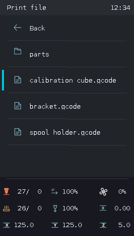
  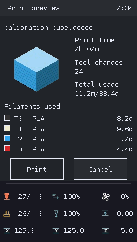
</p>

1. Open **Home → Print**. Select a folder or G-code file. Folders appear first; **Back** goes up one level, or returns Home from the root.
2. Check the model preview, estimated time, tool changes, total filament length/weight and used filament colors/materials/weights when the slicer supplies them.
3. Select **Print** and press to start, or **Cancel** to return to the same file. Cancel is initially selected.

The browser follows Mainsail's name/date/size sorting and direction. Without a valid preference, newest files appear first. Hidden folders and non-G-code files are excluded.

Missing thumbnails or metadata do not prevent printing. Up to four used tools are shown; tool IDs such as T0 are slicer tools, not physical MMU gate numbers. Common previews are prepared ahead of time to make browsing faster.

## Printing and Tune

<p align="center">
  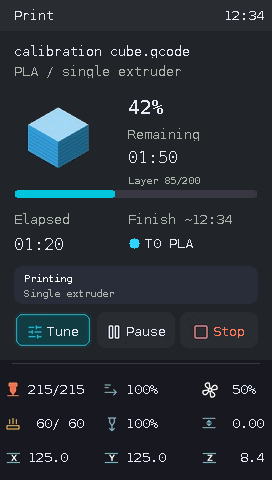
  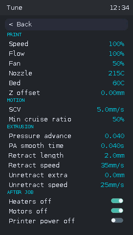
</p>

The print screen shows the file, progress and elapsed/remaining time. Use **Pause**, **Resume** or **Stop** as needed. Open **Tune** to change print speed, available hotend/bed/fan settings or runtime Z offset. Flow is shown on the dashboard; it has no LCD editor.

Runtime Z offset adjusts the current session. It does not save a permanent probe offset. If an action fails or its result is unclear, check Mainsail before repeating it.

## Prepare and Live jog

<p align="center">
  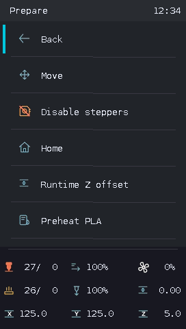
  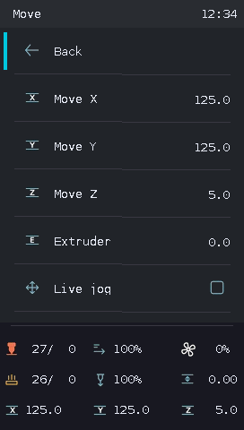
  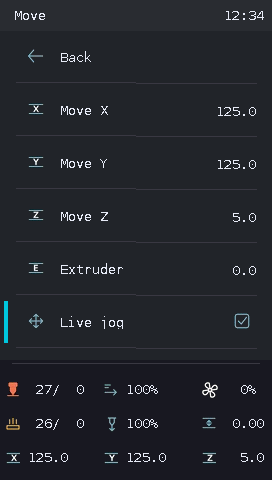
</p>

**Prepare → Home** homes the printer. **Disable steppers** releases the motors. **Runtime Z offset** changes the current session's offset.

In **Prepare → Move**, select X, Y, Z or Extruder, edit the value and press to apply. With **Live jog [X]** enabled, encoder edits move immediately; with **[ ]**, the movement is applied when confirmed.

Home the required axes first. Movement is unavailable during printing or pauses, and travel limits are enforced. Heat the nozzle before extrusion. If a failed jog leaves movement locked, check the printer and use **Control → Restore jog state** when offered.

## Temperature and preheat presets

<p align="center">
  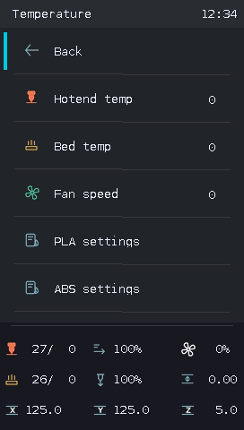
  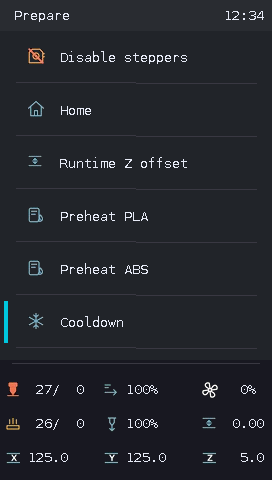
</p>

- **Prepare → Preheat [name]** applies a preset. **Cooldown** turns off the heaters.
- **Control → Temperature** changes available hotend, bed and fan targets.
- Open a preset's **[name] settings**, edit its heater targets and choose **Save settings**. Saving the preset does not start heating.

Preset names and heater targets are shared with Mainsail when available; LCD edits are saved back there. Without Mainsail presets, local presets are used. Fan settings are not synchronized as temperature presets.

## Runtime motion limits

<p align="center">
  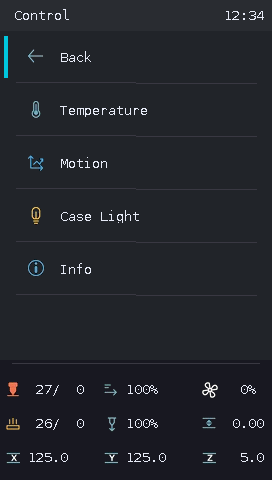
  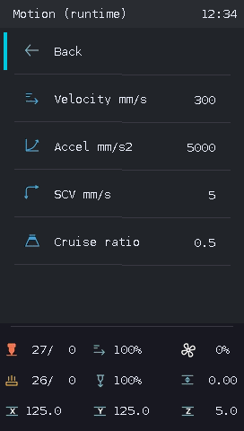
</p>

Open **Control → Motion** to adjust maximum velocity, maximum acceleration, square-corner velocity and minimum cruise ratio when supported. Press a field, rotate and press to apply. Changes are runtime settings; edit your Klipper configuration separately if you want permanent defaults.

## Screw adjustment

Requires a probe and four distinct corner screws in Klipper's `[screws_tilt_adjust]` configuration.

<p align="center">
  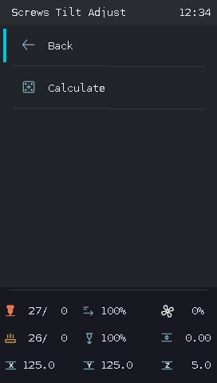
  
  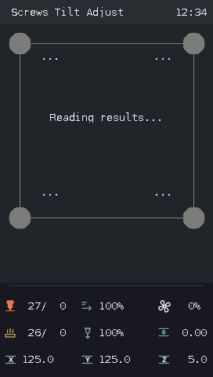
  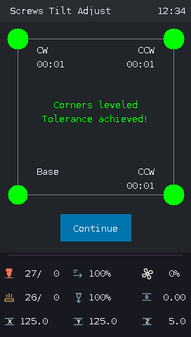
</p>

1. Open **Leveling → Screws Tilt Adjust → Calculate**. Missing axes are homed before measurement.
2. Wait through **Probing corners…** and **Reading results…**.
3. Leave the **Base** screw unchanged. Turn the other screws according to **CW** (clockwise) or **CCW** (counter-clockwise) and the displayed amount. `01:20` means one full turn plus 20/60 of a turn.
4. Choose **Continue**, adjust as needed and calculate again. Green **Corners leveled / Tolerance achieved!** means the measured highest-to-lowest difference is below **0.05 mm**.

The screws are adjusted by you; the screen measures and gives instructions. This workflow does not save configuration.

## Bed mesh and saved profiles

<p align="center">
  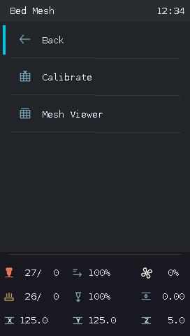
  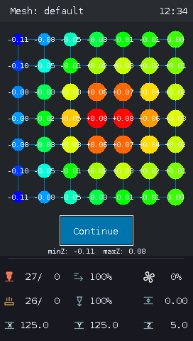
  
</p>

Open **Home → Leveling → Bed Mesh**. With a configured probe, **Calibrate** homes missing axes and measures the bed. After measurement, inspect the colored height map and minimum/maximum Z values.

- **Continue** returns to the menu and keeps the measured mesh for the current session.
- **Save** asks you to confirm the profile and restart. The measured mesh is saved as a generated `lcd_mesh_N` profile; Klipper restarts. Unrelated pending configuration changes can block saving.
- **Mesh Viewer** lets you inspect Current Mesh or saved profiles. Viewing does not load a profile, move the printer or change the active mesh. Low Y is at the bottom of the map.

**Cancel → Stop during measurement is an emergency stop:** Klipper enters shutdown. Use `FIRMWARE_RESTART` from the web console to recover. Cancel the confirmation if you want measurement to continue.

## Probe-offset calibration

1. Ensure the bed is clear for calibration. The screen homes XYZ when needed, raises Z for clearance and moves the probe to the configured bed center before probing.
2. Open **Leveling → Probe Calibration → Start**.
3. Watch the live Z height between the lower and upper tested positions. Turn the knob to select one of the four **-- / - / + / ++** buttons and press it to move using Klipper's search steps.
4. Select **Accept** when satisfied, or **Cancel** to cancel the session.
5. After Accept, choose **Save** to persist the offset and restart Klipper, or **Continue** to leave it unsaved.

Printing must be stopped. Pending configuration changes do not block calibration. Saving is allowed only when the pending change is the accepted probe offset. Saving restarts Klipper; this is separate from the temporary runtime Z offset.

## Display settings

<p align="center">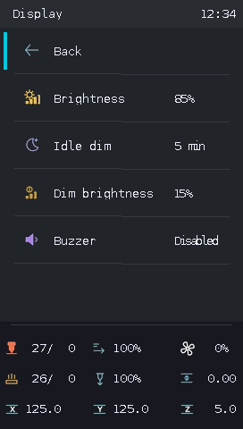</p>

Open **Home → Display**:

| Setting | Use |
|---|---|
| Brightness | Normal brightness, 0–100%; changes are visible while editing |
| Idle dim | Off, or 1–60 minutes without encoder input before dimming |
| Dim brightness | Brightness while dimmed, 0–100%; limited by normal brightness |

Press to edit, rotate and press again to save. Settings survive display power cycles. Defaults are **100%**, **Off** and **10%**. If saving fails, the edit stays open; press to retry.

The first encoder movement or click after idle dimming wakes the display without performing a menu action. **0% turns off the backlight**; while editing Brightness, rotate clockwise to increase it again.

## Maintenance

**Home → Maintenance** is the tile before Info. It currently contains only **Back**, which returns to the same home tile.

## Info and updates

<p align="center">
  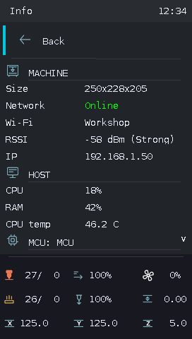
  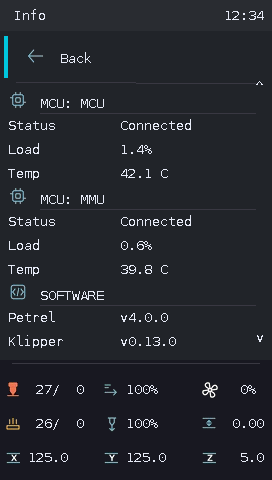
  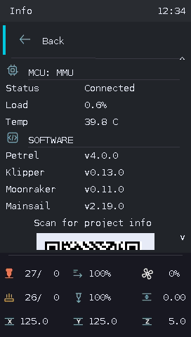
  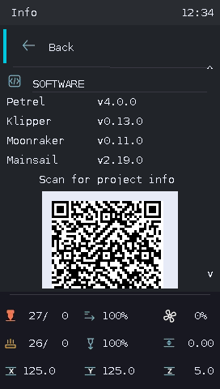
</p>

Open **Home → Info** or **Control → Info**, then rotate to scroll through Machine, Host, MCUs and Software. Check printer dimensions, network/IP, Wi-Fi name/signal, CPU/RAM/temperature, MCU connection/load/temperature and installed software versions. Unavailable values show `N/A` or an unavailable status. MCU temperature needs a configured `temperature_mcu` source; Wi-Fi details require Linux `iw`.

<p align="center">
  
  
  
</p>

Scan the project QR to open the repository. To update from the LCD:

1. Leave the printer idle and scroll to **Check for updates**. Press the encoder.
2. Wait for **Checking…**. Green **Up to date** means no update is needed; an available update changes the button to **Update**.
3. Select **Update** to install KlipperDWIN. Moonraker restarts the service afterwards. This does not update every printer component.

If the checkout is dirty or invalid, **Soft recovery** offers a second **Confirm recovery** step. Recovery discards local repository changes; back up anything you need first. Rotating cancels confirmation. Recovery does not automatically install an update. If a result is unconfirmed, check Mainsail Update Manager before retrying.

## Case light

<p align="center">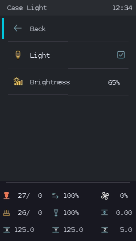</p>

**Control → Case Light** appears for a configured `output_pin case_light`. Use On/Off and adjust PWM brightness from 0–100%. On restores the last positive brightness, or 100% when none is known. No macro is needed.

A PWM-capable output can be configured as follows; replace `PA3` with your actual light-control pin:

```ini
[output_pin case_light]
pin: PA3
pwm: True
value: 1.0
shutdown_value: 0
cycle_time: 0.01
```

## Printer power

Configure the Moonraker power-device name with `./configure.sh`. Hold the encoder button to turn it on; the default hold is **2 seconds**. This works while Klipper or the display is offline, provided the Pi/service and Moonraker remain available.

To turn off, rotate counter-clockwise from the first menu item (Back on MMU pages) to focus the top-right power icon. Press to open **Turn off printer?**; **Yes is selected initially**. Confirm Yes to switch off the configured device, or select No to return.

When a relay powers both the printer and display while the Pi stays running, powering back on returns to the first Home page. Wait for startup to finish before using the menus.
