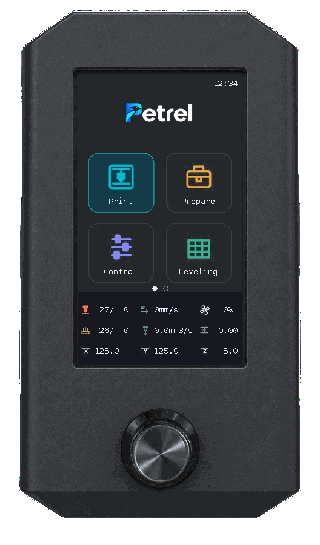
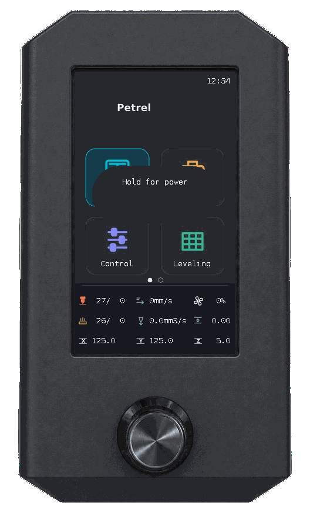

# Günlük kullanım

[English](user-guide.md) · [Türkçe](user-guide_TR.md) · [Dokümantasyon](README_TR.md)

## Gezinme ve durum alanı

<p align="center">
  
  
</p>

Seçimi taşımak için çevirin; seçmek için basın. Sayısal değere basın, düzenlemek için çevirin ve uygulamak için tekrar basın. **Back** önceki ekrana döner. Ana ekran her sayfada dört ikon gösterir; sayfa değiştirmek için çevirmeye devam edin. Noktalar aktif sayfayı belirtir. İsteğe bağlı öğeler yazıcınızın yapılandırmasına bağlıdır.

Alt durum alanının üç satırı aşağıdadır. Hız/akış alanları iki saniyede bir çarpan ile anlık ölçüm arasında değişir. Tune, sayı düzenleyicisi, tam hata okuyucusu ve MMU sayfalarında bu alan görünmez.

| Satır | Sol | Orta | Sağ |
|---|---|---|---|
| 1 | Nozul gerçek/hedef (°C) | Hız çarpanı (%) / anlık hız (mm/s) | Fan (%0–100) |
| 2 | Tabla gerçek/hedef (°C) | Akış çarpanı (%) / hacimsel akış (mm³/s) | Oturum Z offset (mm) |
| 3 | X (mm) | Y (mm) | Z (mm) |

Fan simgesi panelin kendi animasyonuyla döner; hız fan yüzdesinden hesaplanır ve 10 ms aralıklara yuvarlanır. Aynı interval için yeniden komut gönderilmez; %0’da durur.



Örnek verilerle gerçek UI emülatörü çıktısıdır.

## Baskı seçme ve başlatma

<p align="center">
  
  
</p>

1. **Home → Print** açın. Klasör veya G-code dosyası seçin. Klasörler önce gelir; **Back** bir üst klasöre, kök klasörde ise ana ekrana döner.
2. Slicer sağlıyorsa model önizlemesini, tahmini süreyi, takım değişimlerini, toplam filament uzunluğu/ağırlığını ve kullanılan filament renklerini/malzemelerini/ağırlıklarını kontrol edin.
3. Başlatmak için **Print** seçip basın veya aynı dosyaya dönmek için **Cancel** seçin. Başlangıçta Cancel seçilidir.

Tarayıcı Mainsail'in ad/tarih/boyut sıralamasını ve yönünü izler. Geçerli tercih yoksa en yeni dosyalar önce gelir. Gizli klasörler ve G-code dışındaki dosyalar gösterilmez.

Eksik thumbnail veya metadata baskıyı engellemez. En fazla dört kullanılan takım gösterilir; T0 gibi takım ID'leri slicer takımlarıdır, fiziksel MMU kanal numarası değildir. Sık açılan önizlemeler gezinmeyi hızlandırmak için önceden hazırlanır.

## Baskı ve Tune

<p align="center">
  
  
  
</p>

Print önizlemeyi, ilerlemeyi, geçen/kalan süreyi, tahmini bitişi ve varsa katman bilgisini gösterir. **Pause / Resume** doğrudan çalışır; **Stop** başlangıçta **Back** seçili onay açar. Baskı bitince **Close** ile Home'a dönün.

**Tune** ile Speed, **Flow**, sıcaklık/fan, Z offset, SCV, minimum cruise ratio, PA/yumuşatma ve firmware retraction ayarlarını değiştirin. Alanlar yapılandırma ve durum verisine bağlıdır. AFTER JOB switchleri yalnız politika pinlerini değiştirir; baskı sonu eylemini makrolarınız belirler. Z offset kalıcı probe kalibrasyonu değildir. [Alanlar, birimler ve hata davranışları](print-controls_TR.md).

## Prepare ve Live jog

<p align="center">
  
  
  
</p>

**Prepare → Home** yazıcıyı home eder. **Disable steppers** motorları bırakır. **Runtime Z offset** mevcut oturumun offset'ini değiştirir.

**Prepare → Move** içinde X, Y, Z veya Extruder seçin, değeri düzenleyin ve uygulamak için basın. **Live jog** kutusu işaretliyken encoder ile düzenleme anında hareket ettirir; kutu boşken hareket onaylandığında uygulanır.

Önce gerekli eksenleri home edin. Baskı ve duraklama sırasında hareket kullanılamaz; hareket sınırları uygulanır. Ekstrüzyondan önce nozulu ısıtın. Başarısız jog sonrası hareket kilitli kalırsa yazıcıyı kontrol edin ve sunulduğunda **Control → Restore jog state** kullanın.

## Sıcaklık ve ön ısıtma presetleri

<p align="center">
  
  
  
</p>

- **Prepare → Preheat [ad]** preset'i uygular. **Cooldown** ısıtıcıları kapatır.
- **Control → Temperature** mevcut hotend, tabla ve fan hedeflerini değiştirir.
- Preset'in **[ad] settings** bölümünü açın, ısıtıcı hedeflerini düzenleyin ve **Save settings** seçin. Preset kaydetmek ısıtmayı başlatmaz.

Mevcutsa preset adları ve ısıtıcı hedefleri Mainsail ile paylaşılır; LCD düzenlemeleri oraya kaydedilir. Mainsail presetleri yoksa yerel presetler kullanılır. Fan ayarları sıcaklık presetleriyle eşitlenmez.

## Çalışma zamanı hareket sınırları

<p align="center">
  
  
</p>

Maksimum hız, maksimum ivme, square-corner velocity ve destekleniyorsa minimum cruise ratio için **Control → Motion** açın. Alana basın, çevirin ve uygulamak için basın. Değişiklikler çalışma zamanı ayarlarıdır; kalıcı varsayılan istiyorsanız Klipper yapılandırmasını ayrıca düzenleyin.

## Vida ayarı

Klipper'ın `[screws_tilt_adjust]` yapılandırmasında probe ve dört ayrı köşe vidası gerektirir.

<p align="center">
  
  
  
  
  
</p>

1. **Leveling → Screws Tilt Adjust → Calculate** açın. Eksik eksenler ölçümden önce home edilir.
2. **Probing corners…** ve **Reading results…** aşamalarını bekleyin.
3. **Base** vidasını değiştirmeyin. Diğer vidaları **CW** (saat yönü) veya **CCW** (saat yönünün tersi) ve gösterilen miktara göre çevirin. `01:20` bir tam tur ve turun 20/60'ı demektir.
4. **Continue** seçin, gerektiğinde ayarlayın ve tekrar hesaplatın. Yeşil **Corners leveled / Tolerance achieved!**, ölçülen en yüksek/en düşük farkın **0,05 mm** altında olduğunu belirtir.

Vidaları siz ayarlarsınız; ekran ölçüm ve yönlendirme yapar. Bu işlem yapılandırma kaydetmez.

## Bed mesh ve kayıtlı profiller

<p align="center">
  
  
  
</p>

**Home → Leveling → Bed Mesh** açın. Probe yapılandırılmışsa **Calibrate** eksik eksenleri home edip tablayı ölçer. Ölçüm sonrası renkli yükseklik haritasını ve minimum/maksimum Z değerlerini inceleyin.

Ölçüm sırasında her prob sonucu ilgili noktaya anında eklenir. Ölçüm bitince ve kayıtlı mesh açılınca renk aralığı o mesh’in minimum/maksimum değerlerine göre yeniden ayarlanır: en alçak nokta mavi, en yüksek nokta kırmızı; aradaki değerler camgöbeği, yeşil ve sarı tonlarıdır.

- **Continue** menüye döner ve ölçülen mesh'i mevcut oturum için korur.
- **Save** profil ve yeniden başlatma onayı ister. Ölçülen mesh oluşturulan `lcd_mesh_N` profiline kaydedilir; Klipper yeniden başlar. İlgisiz bekleyen yapılandırma değişiklikleri kaydı engelleyebilir.
- **Mesh Viewer**, Current Mesh veya kayıtlı profilleri incelemenizi sağlar. Görüntülemek profil yüklemez, yazıcıyı hareket ettirmez ve aktif mesh'i değiştirmez. Düşük Y haritanın altındadır.

<p align="center">
  
  
  
  
</p>

**Ölçüm sırasında Cancel → Stop acil durdurmadır:** Klipper shutdown durumuna girer. Kurtarmak için web konsolundan `FIRMWARE_RESTART` kullanın. Ölçümün sürmesini istiyorsanız onayı iptal edin.

## Probe offset kalibrasyonu

<p align="center">
  
  
  
</p>

1. Kalibrasyon için tablayı boşaltın. Ekran gerektiğinde XYZ eksenlerini home eder, güvenli geçiş için Z’yi yükseltir ve probu yapılandırılmış tabla merkezine götürür.
2. **Leveling → Probe Calibration → Start** açın.
3. Alt ve üst denenmiş konumların arasında canlı Z yüksekliğini izleyin. Düğmeyi çevirerek dört **-- / - / + / ++** butonundan birini seçin ve basarak Klipper'ın arama adımlarıyla hareket edin.
4. Uygunsa **Accept**, oturumu iptal etmek için **Cancel** seçin.
5. Accept sonrası kalıcı kayıt ve Klipper'ı yeniden başlatmak için **Save**, kaydetmeden çıkmak için **Continue** seçin.

Baskı durmuş olmalıdır. Bekleyen yapılandırma değişiklikleri kalibrasyonu engellemez. Kayıt yalnızca bekleyen değişiklik kabul edilen prob ofsetinden oluşuyorsa yapılabilir. Kayıt Klipper'ı yeniden başlatır; geçici çalışma Z ofsetinden ayrıdır.

## Ekran ayarları

Üst bar, Raspberry Pi'nin yerel sistem saatini **SS:DD** biçiminde gösterir.

<p align="center"></p>

**Home → Display** açın:

| Ayar | Kullanım |
|---|---|
| Brightness | Normal parlaklık, %0–100; değişiklik düzenleme sırasında görünür |
| Idle dim | Off veya encoder girdisi olmadan 1–60 dakika sonra kısma |
| Dim brightness | Kısılmış parlaklık, %0–100; normal parlaklıkla sınırlanır |

Düzenlemek için basın, çevirin ve kaydetmek için tekrar basın. Ayarlar ekranın güç döngüsünde korunur. Varsayılanlar **%100**, **Off** ve **%10**'dur. Kayıt başarısızsa düzenleme açık kalır; yeniden denemek için basın.

Boşta kısma sonrası ilk encoder hareketi veya tıklama, menü işlemi yapmadan ekranı uyandırır. **%0 arka ışığı kapatır**; Brightness düzenlerken saat yönünde çevirerek tekrar artırın.

### Buzzer ve tuş sesleri

<p align="center">
  
  
  
</p>

Yapılandırılmış `[pwm_cycle_time ad]` çıkışlarından birini veya **Disabled** seçmek için **Display → Buzzer** açın. Seçime basınca kaydedilir ve Display’e dönülür. Kullanılabilir bir çıkış seçiliyken **Volume**, **Click tone** ve **Encoder tone**, Display’de Buzzer’ın altında görünür.

Ses ayarına basın, çevirmeyle değiştirin ve tekrar basarak kaydedin. Ses seviyesi %0–100 arasında 10’ar adımla değişir. Tonlar Off, Tick, Short beep, Low, High ve Double seçeneklerini içerir. Çıkış ve ses tercihleri yeniden başlatmada korunur. Sesler arka planda çalar; hızlı çevirmelerde birikmez. Seçili section Klipper yapılandırmasından kaldırılırsa kullanılabilir bir çıkış seçilene kadar ses kontrolleri gizlenir.

## Bakım

<p align="center">
  
</p>

**Home → Maintenance**, Info’dan önceki menüdür. Şimdilik yalnızca **Back** seçeneğini içerir; bu seçenek ana menüde aynı ikona döner.

## Info ve güncellemeler

<p align="center">
  
  
  
  
</p>

**Home → Info** veya **Control → Info** açın; Machine, Host, MCUs ve Software bölümlerini kaydırmak için çevirin. Yazıcı boyutlarını, ağ/IP'yi, Wi-Fi adını/sinyalini, CPU/RAM/sıcaklığı, MCU bağlantısını/yükünü/sıcaklığını ve kurulu yazılım sürümlerini kontrol edin. Bulunamayan değerlerde `N/A` veya kullanılamıyor durumu gösterilir. MCU sıcaklığı yapılandırılmış `temperature_mcu` kaynağı, Wi-Fi ayrıntıları Linux `iw` gerektirir.

<p align="center">
  
  
  
</p>

`feature/graphite-theme` kullanıyorsanız dalı korumak için [geliştirme dalı güncelleme adımlarını](installation_TR.md#geliştirme-dalını-güncelleme) izleyin; aşağıdaki Update/Soft recovery yolu `master` kurulumları içindir.

Repoyu açmak için proje QR kodunu tarayın. LCD'den güncellemek için:

1. Yazıcıyı boşta bırakın ve **Check for updates** düğmesine kaydırın. Encodere basın.
2. **Checking…** aşamasını bekleyin. Yeşil **Up to date** güncelleme gerekmediğini gösterir; güncelleme varsa düğme **Update** olur.
3. Petrel'i yüklemek için **Update** seçin. Moonraker ardından servisi yeniden başlatır. Bu işlem tüm yazıcı bileşenlerini güncellemez.

Repo kirli veya geçersizse **Soft recovery**, ikinci bir **Confirm recovery** adımı sunar. Kurtarma yerel repo değişikliklerini siler; gerekenleri önceden yedekleyin. Çevirmek onayı iptal eder. Kurtarma otomatik güncelleme yüklemez. Sonuç doğrulanmamışsa tekrar denemeden önce Mainsail Update Manager'dan kontrol edin.

## Kabin ışığı

<p align="center"></p>

**Control → Case Light**, yapılandırılmış `output_pin case_light` için görünür. On/Off kullanın ve PWM parlaklığı %0–100 ayarlayın. On son pozitif parlaklığı, bilinmiyorsa %100'ü geri getirir. Makro gerekmez.

PWM destekli çıkış aşağıdaki gibi ayarlanabilir; `PA3` yerine gerçek ışık kontrol pininizi yazın:

```ini
[output_pin case_light]
pin: PA3
pwm: True
value: 1.0
shutdown_value: 0
cycle_time: 0.01
```

## Yazıcı gücü

<p align="center">
  
</p>

Moonraker güç aygıtı adını `./configure.sh` ile ayarlayın. Açmak için encoder düğmesini basılı tutun; varsayılan süre **2 saniye**. Pi/servis ve Moonraker erişilebilir kaldığı sürece Klipper veya ekran çevrimdışıyken de çalışır.

Her ekrandan kapatma onayına ulaşmak için encoder düğmesini **1,2 saniye basılı tutup bırakın**. İlk 450 ms boyunca gösterge çıkmaz; ardından küçük **Hold for power** penceresi açılır ve içindeki çubuk dolar. **Cancel başlangıçta seçilidir**; saat yönünde çevirerek **Power off** seçin ve ayrı bir kısa basışla onaylayın. Cancel aynı ekrana ve kaydedilmemiş düzenleme değerine döner. Baskı, duraklatılmış baskı veya süren işlem sırasında kapatma engellenir. Kısa basış bırakıldığı anda çalışır; ek bekleme yoktur. 450 ms–1,2 saniye arasında bırakılan yarım uzun basış menüyü tetiklemez.

Pi çalışmaya devam ederken röle yazıcı ve ekranı birlikte besliyorsa, yeniden güç açıldığında ilk ana ekran sayfasına dönülür. Menüleri kullanmadan önce açılışın bitmesini bekleyin.

Yapılandırılmış Moonraker güç cihazı açıldığında Petrel, LCD için 150 ms aralıklarla bloklamayan handshake denemelerini başlatır. Bu cihaz yoksa aynı hızlı bağlantı penceresini Klipper’ın hazır duruma geçmesi tetikler. 10 saniye yanıt alınamazsa handshake istekleri 5 saniye aralığa döner. Bağlantısı doğrulanan panel, sabit 750 ms uyanma beklemesi olmadan kullanılır.

### Güç akış örneği



Örnek verilerle gerçek UI emülatörü çıktısıdır. [Özgün panel PNG'leri](screenshots_TR.md) ve [yeniden üretim](ui-emulator_TR.md#png-çerçeve-ve-gif-yenileme).
